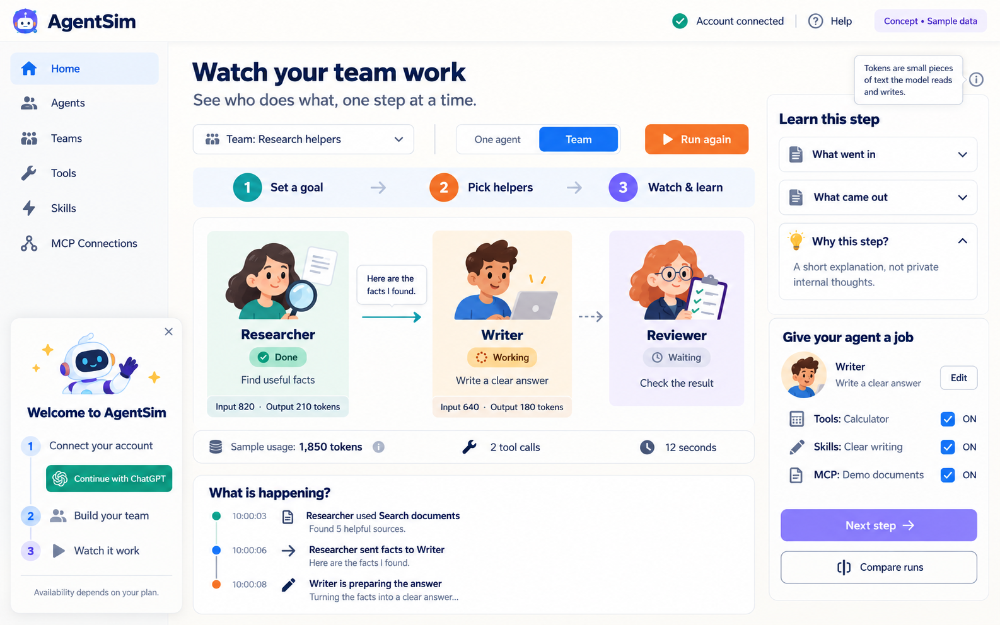

# WABIX AgentSim

Watch a small team of AI helpers work, one job at a time. Built for beginners, family learning and professional demonstrations. All interface text is plain English.



## Start

Requires Python **3.12** and macOS, Linux or Windows (use the Python commands on Windows). No Node build is needed.

```sh
git clone https://github.com/felippeferrao/AgentSim.git
cd AgentSim
./start.sh
```

`start.sh` creates an isolated environment and installs the pinned dependencies. If `uv` is installed it can obtain Python 3.12 automatically. Otherwise install Python 3.12 first. Manual setup:

```sh
python3.12 -m venv .venv
.venv/bin/python -m pip install -r requirements.lock
.venv/bin/python server.py
```

Open **http://127.0.0.1:8080**. Change the port with `PORT=8081 ./start.sh`. The app binds only to loopback. For a simple remote server, run it there and use an SSH tunnel (`ssh -L 8080:127.0.0.1:8080 your-server`). Open the loopback address on your own computer so the OAuth callback uses that tunnel. This is a single-user app, not a public multi-user service.

## Try it

1. Open **Agents**. Edit each job. Explicitly check its tools, skills and individual MCP tools.
2. Open **Teams**. Pick the helpers that work together. They run in the order shown.
3. In **Home**, write a goal such as “Plan a picnic for five people.” Choose One agent or Team.
4. For a sample lesson, keep Demo and press Start demo, then Next step. Compare two saved runs.
5. For real AI, open **Connection setup**. Choose your own connection, load/select a model, save, then press Run with AI. Real execution runs automatically; Next step is the guided Demo/review control.

### Sign in with ChatGPT (preferred)

Press **Continue with ChatGPT**. AgentSim creates its own host identity and starts the official dynamic public-client OAuth flow. Approve the requested ChatGPT plan permission in your browser. After returning, choose **ChatGPT**, load your account's models, choose one and save.

No pre-existing Codex/Cortex token, partner key or client secret is used. Access depends on the account's eligibility and granted scopes. See [official registration guide](https://developers.openai.com/siwc/token-sharing-open-source/sign-in) and [inference contract](https://developers.openai.com/siwc/token-sharing-open-source/models-and-inference).

**Verification limit:** the authorization URL was opened in an automated browser on 2026-10-20 and OpenAI returned HTTP 403 (“Um momento…” challenge). No human consent, token exchange or external inference was completed. The callback, JWT validation, refresh and Responses adapter are implemented; a successful live OAuth-to-CrewAI run remains unverified.

### Alternative: your API provider

Choose **API provider** and enter a key **locally in the app**, never in chat. Advanced settings accept an HTTPS base URL for a provider supporting **streaming Responses API**, or a loopback HTTP endpoint. This is an alternative you explicitly select; it never silently replaces ChatGPT. Chat Completions-only providers are not supported yet.

Credentials live in ignored `.local/` files, atomically written with `0600` permissions. They are excluded from setup exports and API settings responses. Local files are protected by OS permissions, not encrypted at rest. Sign out removes local OAuth tokens; revoke app access in ChatGPT to revoke remote permission. Use trusted local accounts.

## What is real?

- **CrewAI 1.15.28** runs actual `Agent`, `Task`, `Crew` and sequential handoffs for real runs.
- A custom `BaseLLM` adapter calls the Responses API with `store=false`, `stream=true`, requiring `response.completed`.
- Real counts come only from provider `usage`; missing counts stay unavailable. No cost estimate is invented.
- The calculator executes a restricted arithmetic AST. No `eval`, shell or arbitrary uploads.
- Teaching documents run through an actual MCP stdio server, with separate search/read permissions. “Check connection” discovers its tools.
- Skills are plain instructions added to the agent/task. Dependencies must already be explicitly enabled or execution fails with a clear message.
- SQLite saves configurations and completed runs. Background job events track steps, tool calls and usage. Private reasoning/LLM trace events are not exposed.
- **Demo** is deterministic sample content, with clearly labeled sample counts and no AI requests.

There is no successful live external-inference result claimed in this initial delivery. See [status](KnowledgeBase/STATUS.md) for exact evidence and remaining work.

## Import and export

Agents/Teams → Export setup downloads a JSON configuration. Import setup validates it on the server and preserves existing saved runs. Files must be JSON objects, at most 200 KB. Executable code and unknown tool permissions are rejected. Tools/MCP installation through imports is not supported.

Skills → Import a skill accepts only a documented plain JSON record. See [import format](KnowledgeBase/IMPORTS.md). It never enables dependencies, executes scripts or downloads packages.

## Verify

```sh
PYTHONPATH=. .venv/bin/python -m unittest discover -s tests -v
node --check static/app.js  # optional, if Node is installed
```

Tests exercise actual CrewAI with a scripted provider, actual MCP subprocess transport, import restrictions, arithmetic restrictions, OAuth state/PKCE isolation and a local Responses SSE contract fixture. Scripted responses/fixture counts are test data, **not proof of external AI inference**.

Project instructions, decisions, architecture and evidence are in [KnowledgeBase](KnowledgeBase/README.md). No public app deployment is included.
