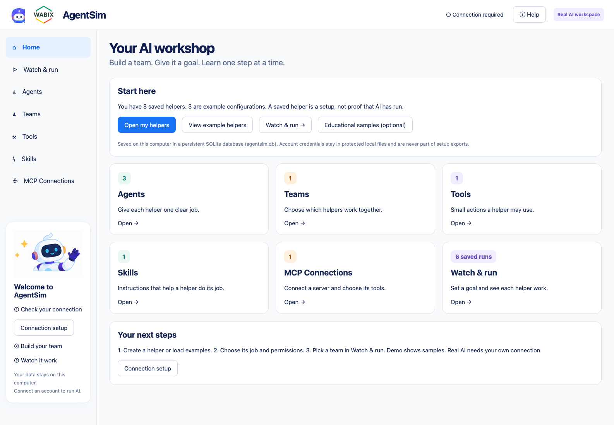

# WABIX AgentSim

Build a team of AI agents and watch real work happen automatically. Plain English, professional design, and concrete explanations for beginners.



## Start

Use Python **3.12**. No frontend build is needed.

For agent-designed editorial HTML/CSS PDFs, install the native Pango runtime first: `brew install pango` on macOS or `sudo apt install libpango-1.0-0 libpangoft2-1.0-0` on Debian/Ubuntu. The standard ReportLab PDF route remains available independently. WeasyPrint is pinned in the Python requirements; on macOS the isolated renderer loads Homebrew libraries automatically.

```sh
git clone https://github.com/felippeferrao/AgentSim.git
cd AgentSim
./start.sh
```

The script creates an isolated environment and installs pinned dependencies. With `uv` it can obtain Python 3.12. Without `uv`, install Python 3.12 first. For manual setup:

```sh
python3.12 -m venv .venv
.venv/bin/python -m pip install -r requirements.lock
.venv/bin/python server.py
```

Open **http://127.0.0.1:8080**. Use `PORT=8081 ./start.sh` to change ports. The app is single-user and binds only to loopback. On a simple remote server, use an SSH tunnel (`ssh -L 8080:127.0.0.1:8080 your-server`), then open that exact loopback address locally so the OAuth callback can follow the tunnel. No public multi-user deployment is included.

## Your workspace

**Home** is a short dashboard with Agents, Teams, Tools, Skills, MCP Connections and Watch & run cards. It explains counts and next steps. It does not start a run. Data is persistent SQLite in `agentsim.db`, not temporary in-memory state. A new installation starts with the clean Comic Story Studio example: six named agents and one managed crew. You can edit the example or keep your own agents. Existing original samples are labeled Example configuration; saved setup is not proof of an AI request.

When Home opens with no provider-verified connection, Connection setup opens automatically. A saved token/key is not presented as successful access: the backend checks the provider's models endpoint. Dismissing the dialog still allows configuration; real execution remains blocked until access is verified.

**Agents** has Import setup / Export setup and six separate editor steps:

1. **Identity** — choose a character, name and role.
2. **Job** — goal, purpose, context, instructions and expected result.
3. **Model & settings** — automatically loaded model dropdown from your connected account, teaching examples and advanced behavior/model settings.
4. **Tools** — explicit tool permissions.
5. **Skills** — instruction packages; dependencies never grant tools silently.
6. **MCPs** — each connection's individual discovered tools.

Back/Next preserve unsaved entries. Models load automatically from the connected account; a failed lookup never invents available models.

The approved Researcher, Writer, Reviewer and Robot characters are selectable and persisted. Profile fields and behavior settings map to actual CrewAI configuration, not decorative metadata. [Mapping and schema](KnowledgeBase/AGENT_PROFILES.md).

**Teams** lets you choose a manager from the team members, plus at least one other agent. The manager decides assignments, asks questions, revisits agents when useful and combines replies. No fixed agent sequence is imposed. Existing teams need a manager selected before running through the UI.

**Watch & run** keeps the approved portraits and visual style. Active agents pulse; the manager visibly waits while delegated work executes. The live conversation shows actual delegation requests, context, replies, tool activity and the final answer through server-sent events. Unused agents stay idle. Select a card to inspect its latest task and answer. No Next clicks are required. Provider tokens are aggregated from the agents actually called.

**Architecture** in the menu shows browser/API/CrewAI/model/MCP/storage components and the saved manager/agent configuration for a selected team. Only configuration-based teaching explanations are shown, never raw private reasoning traces. Failed runs show errors and never switch to samples.

**Educational samples** are secondary and explicitly chosen. Only that optional mode uses deterministic samples and a Next step lesson. Sample token counts are labeled; they are never real provider usage. Compare runs lets you inspect saved results.

## Connect ChatGPT

In Connection setup press **Continue with ChatGPT**, complete the official browser flow, then Check connection again. Keep AgentSim running for the loopback callback. In each agent's Model & settings step, the connected account's models load automatically. Choose that agent's model; there is no connection selector.

AgentSim uses its own dynamic open-source client registration, host identity, PKCE, nonce, issued client id, JWT validation and protected credential files. It never reads Codex/Cortex credential stores. ChatGPT plan permission is separate from identity. [Official sign-in guide](https://developers.openai.com/siwc/token-sharing-open-source/sign-in), [inference contract](https://developers.openai.com/siwc/token-sharing-open-source/models-and-inference).

**External inference remains unverified in this change:** the existing account passed access checks and returned seven models. The earlier automated sign-in encountered a 403 browser challenge; that historical result does not describe the currently connected account. No external AI inference was performed during this implementation. [OAuth review and human test steps](KnowledgeBase/OAUTH_REVIEW.md).

### Explicit API alternative

Open Alternative: your API connection and enter your own key locally, never in chat. Use an HTTPS base URL supporting streaming Responses, or HTTP loopback for a local service. Save and check, then choose a model for each agent from the automatically loaded catalog. Global settings hold connection credentials; they do not override agent models. Chat Completions-only providers are not supported. Optional temperature/output settings are sent only when set, and unsupported settings produce an error without silent fallback.

Credentials stay in ignored `.local/` files, written atomically with `0600` permissions. They are excluded from exports and public settings responses. This is OS file protection, not encryption at rest. Sign out clears local OAuth credentials; revoke remote access in ChatGPT settings if required.

### Local data and GitHub distribution

GitHub distributes the application source, assets and dependency lockfile. Each installation creates its own SQLite database automatically on first use; no personal database, saved conversations, generated outputs or personal connection configuration is shipped. The only versioned database is the sanitized configuration-only starter fixture at `examples/comic-studio/starter.sqlite3`, matching `configuration.json`. The default database is `agentsim.db`; `AGENTSIM_DB` can select another local SQLite file. Operational database files and their journal/WAL files are ignored by Git; only that explicitly named starter fixture is exempt.

Configure your own ChatGPT/OpenAI connection locally after cloning. Credentials, OAuth sessions, native image runtime state and generated artifacts remain under ignored `.local/`. Environment files, common credential filenames and private key files are also ignored. Never add real secrets to source code or examples, or force-add ignored local files. Publishing this repository does not publish a running service or share the owner's account: the application listens only on `127.0.0.1`.

## Connect external MCP servers

MCP Connections → Add HTTP connection → enter the **Streamable HTTP** endpoint and optional Bearer/custom-header credential → Save → Discover tools → assign specific tools in each agent's MCPs tab.

Discovery and calls use the real MCP SDK. Editing/removing connections or changing tool definitions revokes affected permissions. Credentials never enter Git, SQLite public catalogs, exports or timeline logs. Runtime validates permissions, connection revision and complete JSON input schema before tools/call. HTTP redirects and remote schema references are blocked. The built-in teaching documents also use real MCP stdio. [External MCP behavior and verification](KnowledgeBase/EXTERNAL_MCP.md).

## Verification and limits

```sh
PYTHONPATH=. .venv/bin/python -m unittest discover -s tests -v
node --check static/app.js
```

Tests include actual CrewAI execution with a scripted LLM, authenticated HTTP MCP server processes, complete app HTTP/SSE runs against a controlled Responses fixture, per-agent heterogeneous models, migration, profile mapping, permissions and OAuth contracts. Fixture responses/counts are **not live external AI**.

The current app supports one ChatGPT registration and one API credential connection, configured in Connection setup. Each agent keeps its own model; legacy profiles retain connection metadata for compatibility. Legacy HTTP+SSE MCP, remote MCP OAuth, arbitrary tool plugins, encrypted credential vault, durable background-job recovery, cancellation and public multi-user hosting remain future work. Completed runs persist; a server restart interrupts in-flight jobs.

See [KnowledgeBase](KnowledgeBase/README.md) for requirements, architecture, evidence and exact delivery status.

## Tools, skills, plugins and execution history

Tools now includes Web Research, PDF Generator, Image Generator and Plotly Chart Generator, in addition to Calculator. Assign individual tools to agents, then the LLM calls them automatically when needed. Generated PDFs, images and interactive/high-resolution charts appear as previews/downloads in Watch & run and Execution history. Plotly static export uses Kaleido and an installed Chrome/Chromium.

Skills imports Codex-format SKILL.md files and supports View/Remove. Managers can choose registered skills with an explicit public reason and apply them to delegated work. New tool grants are never inferred from skill instructions.

MCP Connections can import a plugin ZIP plus an access key, inspect .mcp.json/mcp.json, register HTTP or trusted Python/Node stdio servers and discover tools. A downloadable example package is included. Local code requires explicit trust; package installers are not run.

Execution history persists running/completed/failed/interrupted/rejected work and every public event with sequence, time, location and implementation class. Historical artifacts remain available. A restart preserves evidence and marks unfinished work interrupted; it does not resume execution.

**Native ChatGPT image generation:** ChatGPT agents use the independently authenticated native Codex image runtime, without an API key. Tools → Image Generator → ChatGPT image connection handles its one-time sign-in. The direct subscription-sharing Responses route still rejects hosted image_generation; this native route is separate. Optional image API accounts remain available for deliberate API setups. Generated images, PDFs and Plotly outputs are attached to the assistant's chat message as well as the execution trace.

[Harness extension contract, class map, Codex skill format, plugin schemas and examples](KnowledgeBase/HARNESS_INTEGRATIONS.md).


## Continue from generated files

Images, PDFs and charts stay in the saved conversation and can be reused after reopening it. Ask to revise a PDF, reuse a character in another image, or turn an image into an illustrated story. “Use in next message” on an attachment inserts its reference. Reuse events in the execution column show which real files were read or embedded.

With **Image Generator** and **PDF Generator** granted, ask: “Construa uma história em 5 capítulos sobre um cachorro viajante. Ilustre cada capítulo e monte um PDF com capa para um e-book.” The agent creates chapter text, actual chapter/cover images and the final PDF, with per-step evidence and an extended budget for that request. Previous images can serve as visual references. Source files remain local and ignored by Git.

## License and credits

Copyright © 2026 **Felippe da Silva Ferrão** — felippeferrao@wabix.net.
**Powered By Wabix.**

The [AgentSim Attribution and Brand Preservation License](LICENSE) allows
use, copies, modifications and redistribution, including commercial use,
while requiring preservation of the original authorship, license and
application brand identification. Copies and modified applications must keep
the visible footer credits. Modified distributions must identify their changes
without implying endorsement. Third-party dependencies retain their own licenses.

This is a custom project license rather than the [standard MIT License](https://opensource.org/license/mit),
which requires preservation of its copyright/permission notice but does not
contain this project's visible-footer and brand-preservation conditions.
Earlier releases retain their original license terms. User-generated content
is not required by this license to carry the application's branding.

Illustrated ebooks must have a distinct cover and a distinct illustration for every chapter. Output validation compares file contents, so repeating one image under different filenames cannot satisfy the request. Native scene-generation calls run sequentially or queue instead of failing when requested together.
